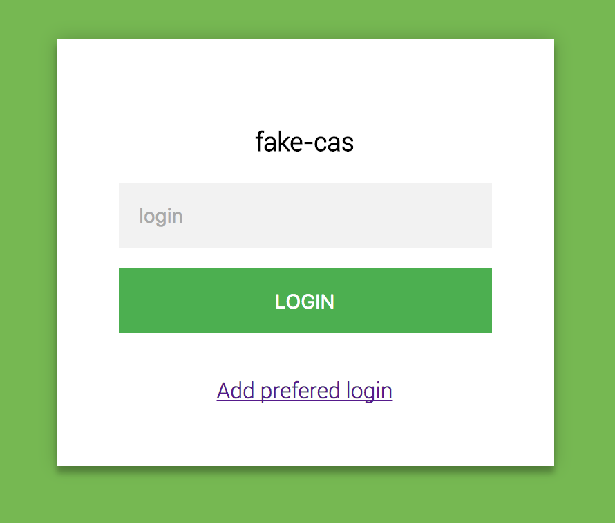

# fake-cas

A small, fake CAS 1.0 server for local development and integration tests.
It accepts any non-empty, single-line username. There is no user directory:
this is a simulator, not a production authentication server.



## Run with Docker

After the first successful GitHub Actions publication, run the image from
GitHub Container Registry (GHCR), without installing Node.js or cloning the repository:

```sh
docker run --rm --name fake-cas -p 3000:3000 ghcr.io/eskan/fake-cas:latest
```

Open http://localhost:3000/login. Favourite logins are saved in the browser's
localStorage, using the existing storage key.

The image supports `linux/amd64` and `linux/arm64`; Docker selects the matching
architecture automatically. Tickets and sessions are stored in memory and lost
when the container restarts.

To require a password and expose the server on port 3001:

```sh
docker run --rm --name fake-cas -p 3001:3000 \
  -e CAS_PASSWORD=secret ghcr.io/eskan/fake-cas:latest
```

To disable the SSO cookie, add `-e NO_COOKIE=1`. The left side of `-p` is the
host port; the right side must match the server's `PORT` (3000 by default).

To update, stop the running container and pull the image before starting it again:

```sh
docker pull ghcr.io/eskan/fake-cas:latest
```

For repeatable integrations, replace `latest` with a published version tag
(for example `v1.2.3`, once that tag has been built) or a `sha-...` tag from GHCR.

### Docker Compose

```yaml
services:
  fake-cas:
    image: ghcr.io/eskan/fake-cas:latest
    ports:
      - "3000:3000"
    environment:
      CAS_PASSWORD: secret
      # NO_COOKIE: "1"
```

Save this as `compose.yaml`, then run `docker compose up -d`.
Update with `docker compose pull && docker compose up -d`.

When your CAS client also runs in Docker, validation can use the Compose service
hostname `http://fake-cas:3000/validate`. Browser redirects must use URLs reachable
from the browser, such as `http://localhost:3000/login` and your application's
public callback URL. Always pass the exact same `service` value to login and validation.

## Configuration

| Variable | Default | Behaviour |
| --- | --- | --- |
| `PORT` | `3000` | HTTP listening port |
| `CAS_PASSWORD` | Unset | When non-empty, require this password for every login; otherwise accept any password, including blank |
| `NO_COOKIE` | Unset | When present (even empty or `0`), disable the SSO session cookie |

```sh
docker run --rm -p 3000:3000 -e CAS_PASSWORD=secret ghcr.io/eskan/fake-cas:latest
docker run --rm -p 3000:3000 -e NO_COOKIE=1 ghcr.io/eskan/fake-cas:latest
```

## CAS flow

1. Navigate to `/login?service=http%3A%2F%2Flocalhost%3A8080%2Fcallback`.
2. Submit the login form. The server redirects to the service URL with a
   `ticket=ST-...` parameter, preserving existing query parameters and fragments.
3. The client calls `/validate?service=http%3A%2F%2Flocalhost%3A8080%2Fcallback&ticket=ST-...`.
   Pass the **exact same service string** used at login, without the added ticket.
4. Successful validation returns `yes\n<login>\n`; failure returns `no\n`,
   both as plain text. Every validation attempt consumes the ticket, even if
   the service is wrong or missing. Tickets expire after five minutes.
5. `GET /logout` or `POST /logout` clears the SSO session and redirects to `/login`.

Without a service, `/login` displays the login or authenticated page. Service
URLs must be absolute HTTP(S) URLs without embedded credentials. Any such
service is accepted, to make local integration easy.

SSO sessions last eight hours. `/login?renew=true` forces the login form;
`/validate?renew=true` only accepts tickets issued after submitting credentials.
`/login?gateway=true&service=...` returns to the service without a ticket when
there is no session. `renew` takes precedence over `gateway`.

Only the CAS 1.0 endpoints `/login`, `/logout` and `/validate` are implemented.
CAS 2/3 XML validation, proxy tickets and single logout callbacks are not supported.

## Build and publish with GitHub Actions

[The Docker image workflow](.github/workflows/docker.yml) runs the tests and
builds both architectures using the repository's Dockerfile:

| Trigger | Result |
| --- | --- |
| Pull request targeting `master` | Tests and image build, without publication |
| Push to `master` | Publish `ghcr.io/eskan/fake-cas:latest` and `sha-...` |
| Push a `v*` tag, such as `v1.2.3` | Publish that exact tag and `sha-...`; keep `latest` unchanged |
| Manual run from the Actions tab | Publish when run on `master` or a `v*` tag; otherwise only build and test |

Publication uses the automatic `GITHUB_TOKEN` with `packages: write`; no registry
secret needs to be configured. The image name follows the GitHub repository name,
so forks publish under their own owner.

After the first publication, open the package settings on GitHub and set its
visibility to **Public** to allow anonymous pulls. If you keep the package private,
log in to `ghcr.io` with a GitHub personal access token (classic) with
`read:packages` before pulling. If a package already exists, ensure this repository
has write access under the package's Actions access settings.

See [GitHub's container publishing documentation](https://docs.github.com/en/actions/tutorials/publish-packages/publish-docker-images).

### Build locally

```sh
docker build -t fake-cas .
docker run --rm -p 3000:3000 fake-cas
```

## Local development

Requires Node.js 24.12 or newer (`nvm use` selects Node.js 24).

```sh
npm ci
npm start
npm run dev # Restart automatically when server code changes
npm test    # HTTP integration tests using Node's built-in test runner
```

No build step is needed. The server is plain JavaScript with Express and cookie-parser.

## Updating an older checkout

Run `npm ci` with Node.js 24.12 or newer. `npm start` now launches the server
directly; use `npm run dev` for watch mode. Webpack, TypeScript and the `dist/`
bundle are no longer used, and `npm run build` has been removed. Replace references
to `amd64.Dockerfile` or `arm64v8.Dockerfile` with `Dockerfile`.

Clients that previously validated tickets without `service` must now include it.
Empty usernames are rejected, and an incorrect configured password returns HTTP 401.

Protocol reference: [Apereo CAS specification](https://apereo.github.io/cas/development/protocol/CAS-Protocol-Specification.html).
